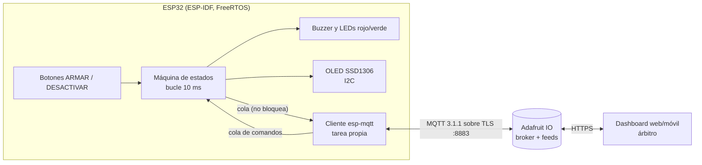

# Bomba IoT: plantar y desactivar (ESP32 + Adafruit IO)

Una "bomba" de juego (para airsoft, gotcha o team building) hecha con un ESP32.
- Un jugador **planta** la bomba manteniendo el botón rojo **3 s** (o desde el dashboard).
- Empieza una cuenta regresiva de **40 s**. El buzzer pita cada vez más rápido.
- El otro equipo la **desactiva** manteniendo el botón verde **5 s**. Si lo suelta, el progreso regresa a 0.
- La pantalla OLED muestra la cuenta regresiva y la barra de progreso. El LED rojo parpadea con cada bip y el verde brilla más conforme se desactiva.
- El ESP32 publica el estado, el tiempo y el progreso en **Adafruit IO por MQTT sobre TLS**. Así un árbitro sigue la partida en vivo desde el celular o la PC, arma o reinicia la bomba a distancia y tiene el historial de las rondas.

## Arquitectura



**Estados:** `espera → plantada → desactivada | exploto → espera`

| Feed (Adafruit IO) | Dirección | Valores | QoS |
|---|---|---|---|
| `bomba-estado`   | ESP32 → nube | `espera`, `plantada`, `desactivada`, `exploto` | 1 |
| `bomba-tiempo`   | ESP32 → nube | 0–40 (s) | 0 |
| `bomba-progreso` | ESP32 → nube | 0–100 (%) | 0 |
| `bomba-cmd`      | nube → ESP32 | `armar`, `reiniciar` | 0 |

**Decisiones de diseño (manejo de errores):**
- El juego **nunca espera a la red**: la red corre en otras tareas y las publicaciones se encolan. Sin WiFi la bomba funciona igual (modo offline).
- WiFi y MQTT **se reconectan solos**. Al reconectar se reenvía el estado actual.
- **Límite de envío:** como máximo 1 mensaje cada 2.2 s, porque el plan gratis de Adafruit IO permite 30 por minuto. El estado tiene prioridad sobre la telemetría.
- **TLS con verificación de certificado** (bundle de certificados de ESP-IDF).
- **Antirrebote** de 30 ms en los botones. Si el botón verde ya estaba apretado antes de plantar, no cuenta.

## Hardware (BOM)

| Componente | Cant. | Notas |
|---|---|---|
| ESP32 DevKit V1 (ESP32-WROOM-32) | 1 | |
| Botón pulsador grande (rojo) | 1 | ARMAR |
| Botón pulsador grande (verde) | 1 | DESACTIVAR |
| Buzzer **pasivo** (placa visible por abajo) | 1 | El ESP32 le da el tono con PWM a 2.7 kHz. Uno activo de 5 V suena muy bajo con 3.3 V |
| Pantalla OLED SSD1306 0.96" 128x64, I2C (4 pines) | 1 | Tiempo, estado y progreso |
| LED rojo y LED verde de 5 mm | 2 | Rojo: bip; verde: progreso de desactivación |
| Resistencia de 220 Ω | 2 | Una por LED |
| 2 protoboards, jumpers, cables dupont macho-hembra de 20 cm, power bank USB | — | |
| Caja de cartón, cinta, tubos para la "dinamita" | — | Carcasa |

## Conexiones

Diagrama interactivo, con el montaje en la caja de cartón: [`docs/conexiones.html`](docs/conexiones.html). Ábrelo en el navegador.

| ESP32 (texto en la placa) | GPIO | Va a |
|---|---|---|
| D18 | 18 | Botón rojo → riel − (usa pull-up interno, no lleva resistencia) |
| D19 | 19 | Botón verde → riel − |
| D23 | 23 | Buzzer (+); el (−) al riel − |
| D22 / D21 | 22 / 21 | SCL / SDA de la OLED |
| D25 | 25 | 220 Ω → LED rojo (pata larga); pata corta al riel − |
| D26 | 26 | 220 Ω → LED verde (pata larga); pata corta al riel − |
| 3V3 | — | Riel + derecho → VCC de la OLED |
| GND (los dos) | — | Rieles − (tierra común) |

Si la OLED muestra el texto de cabeza, cambia `OLED_GIRAR` a `true` en `main/main.c`. Si no hay pantalla conectada, la bomba funciona igual y solo lo avisa en el monitor serie.

## Compilar y flashear

Requisitos: ESP-IDF **v5.5** (extensión de VS Code o terminal "ESP-IDF").

```bash
git clone <este-repo> && cd bomba_iot
cp main/config.example.h main/config.h   # y edita WiFi + usuario/AIO key
idf.py set-target esp32
idf.py build
idf.py -p COM3 flash monitor             # cambia COM3 por tu puerto
```

## Configurar Adafruit IO

1. Crea una cuenta en https://io.adafruit.com. Tu usuario y tu **AIO Key** están en el icono de la llave; ponlos en `config.h`.
2. En **Feeds**, crea `bomba-estado`, `bomba-tiempo`, `bomba-progreso` y `bomba-cmd`.
3. En **Dashboards**, crea "Bomba" con estos bloques:
   - **Text** o **Indicator** → `bomba-estado`
   - **Gauge** de 0 a 40 → `bomba-tiempo`
   - **Gauge** de 0 a 100 → `bomba-progreso`
   - **Momentary Button**: press value `armar`, release value `-` → `bomba-cmd`
   - **Momentary Button**: press value `reiniciar`, release value `-` → `bomba-cmd`
   - **Line chart** → `bomba-tiempo` y `bomba-progreso` (historial)

## Logs para pruebas

El monitor serie imprime eventos en formato CSV:
```
I (12345) bomba: EVT,12345,plantada
I (30000) bomba: CMD,30000,reiniciar
```
Además, Adafruit IO guarda cada dato con su hora del servidor. Se puede descargar en CSV desde la página de cada feed.
